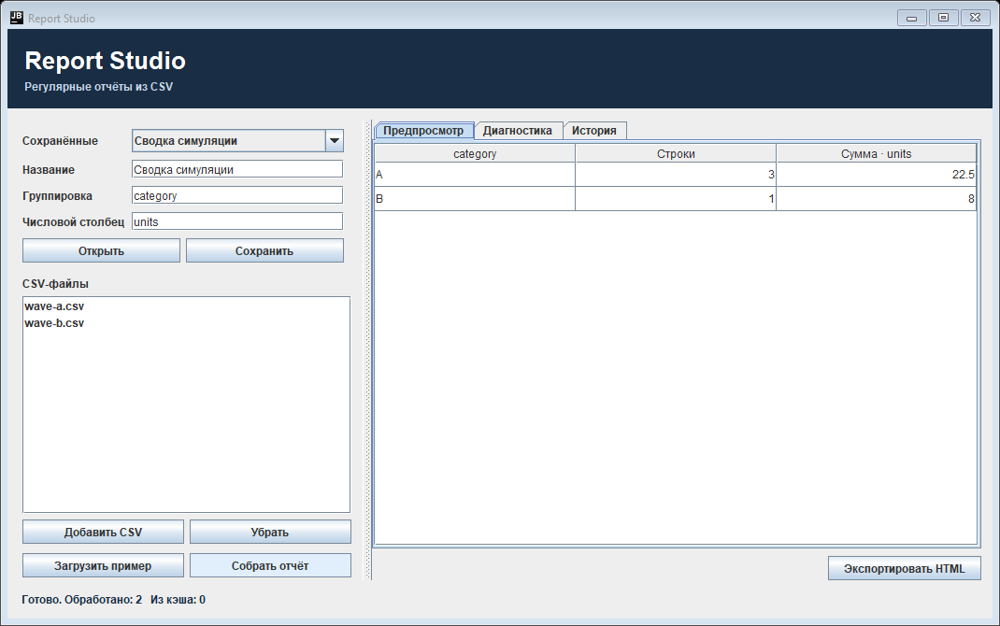

# Report Studio

Настольное приложение на Java для регулярных сводок по CSV. Подходит небольшой команде, которая каждую неделю объединяет несколько выгрузок, или человеку, который ведёт журнал тренировок и хочет видеть итоги по категориям. В одном окне можно сохранить шаблон, проверить данные, увидеть сводку и экспортировать HTML-отчёт.

Идею обработки данных по сохраняемым этапам подсказали Kestra и Apache NiFi из GitHub Trending по Java. [Kestra](https://github.com/kestra-io/kestra) · [Apache NiFi](https://github.com/apache/nifi) · [GitHub Trending](https://github.com/trending/java)



## Запуск

Нужен JDK 21 или новее и рабочий стол с поддержкой Java Swing. В папке проекта выполните команды.

```bash
javac -encoding UTF-8 -d out ReportEngine.java StudioStore.java ReportStudio.java
java -cp out ReportStudio report-studio-data examples
```

Первый аргумент задаёт папку данных приложения, второй — папку демонстрационных CSV. Без аргументов данные сохраняются в `.report-studio` в домашней папке, а примеры ищутся в `examples` рядом с текущим рабочим каталогом.

## Демонстрация

1. Нажмите **Загрузить пример**. Приложение заполнит шаблон и подставит две синтетические выгрузки из учебного симулятора.
2. Нажмите **Сохранить** и **Собрать отчёт**. В предпросмотре у группы A будет три строки с суммой **22,5**, у B — одна строка с суммой **8**.
3. Нажмите **Экспортировать HTML**. Готовый файл появится в папке `report-studio-data/exports`. Путь будет во вкладке **Диагностика**.
4. Чтобы воспроизвести ошибку, выделите `wave-b.csv`, нажмите **Убрать** и добавьте `wave-b-invalid.csv` через **Добавить CSV**. После сборки диагностика укажет файл и строку 2. Первая выгрузка сохранит свой результат в кэше.
5. Замените в списке ошибочный файл на `wave-b.csv` и повторите сборку. Вкладка **История** покажет успешные и неудачные запуски. Шаблон можно открыть после перезапуска приложения и использовать с новыми выгрузками.

Для своих данных впишите точные названия двух разных столбцов. Первый задаёт группу, второй — числовую величину. Поддерживаются CSV с запятой и кодировкой UTF-8, в том числе с BOM. Дробная часть отделяется точкой. Кавычки позволяют использовать запятые и переносы строк внутри поля.

## Как сохраняется работа

- Сборка выполняется в фоне. Для каждого исходного файла отдельно проверяются заголовки и строки и считаются сумма и число записей по группам. Для сумм используется `BigDecimal`.
- Контрольная точка хранит результат обработки файла и SHA-256 его содержимого. Ключ учитывает путь и выбранные столбцы. При смене содержимого этот файл обрабатывается заново. Если одна выгрузка не прошла проверку, приложение сохраняет результаты остальных файлов и показывает диагностику.
- Шаблоны, история, кэш и HTML хранятся локально. Каждый файл состояния записывается через временный файл и атомарную замену. Для экспорта нужен полностью собранный отчёт.

Приложение загружает один CSV целиком и рассчитано на выгрузки, которые помещаются в память. Папка данных должна быть доступна для записи и находиться на файловой системе с поддержкой атомарного переименования. SHA-256 требует прочитать файл при повторной сборке, но позволяет пропустить разбор CSV и агрегацию. Имена шаблонов служат ключами, поэтому повторное сохранение имени обновляет шаблон.

## Проверки

```bash
javac -encoding UTF-8 -d out ReportEngine.java StudioStore.java ReportStudio.java ReportStudioTest.java
java -cp out ReportStudioTest
```

Тест открывает окно и выполняет сценарий через кнопки приложения. Он проверяет сохранение и открытие шаблона, предпросмотр, HTML, диагностику и историю после перезапуска. После исправления файла сверяются число переиспользованных результатов и итоговая таблица из чистой сборки. Отдельно проверяются кавычки и многострочные поля CSV, точное сложение и экранирование HTML.
